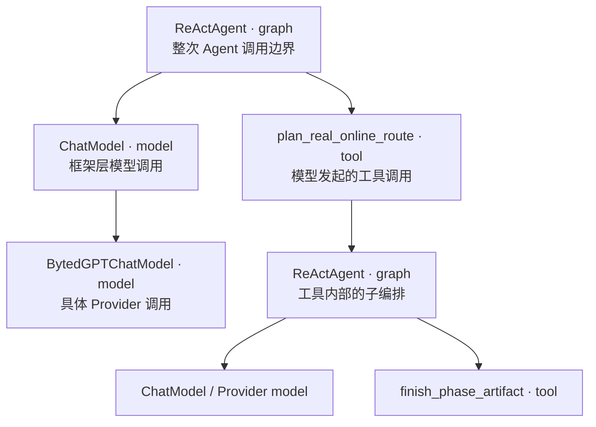

# Fornax Trace 使用与数据语义报告

> 调研对象：用户提供的已完成 LogID 的 Fornax Trace 页面，调研时间：2026-07-16。
>
> 本文只记录产品行为和字段类别；请求正文、提示词正文、运行环境标识、文件路径、调用 ID、签名 URL、Header 等敏感值均已省略或泛化。结论来自这一条真实 trace，因此把“页面观察到的事实”和“基于 span 关系作出的解释”明确分开。

## 1. 这不是一棵单纯的调用树

Fornax 的核心是将一次 Agent 执行拆成一组有起止时间、输入、输出、状态和上下文的 span。页面首先以 **执行包含关系** 组织它们，随后再提供一个 **会话叙事关系**（Chat）来阅读。



上图是调研样本的一段缩略结构。实际树中同一条主流程还包含多次模型调用、工具调用与嵌套 graph，页面对超大 trace 做了折叠（样本提示有数百个节点被隐藏，可手动“点击展示”）。

要特别避免两个误读：

- 父 span 的耗时通常覆盖子 span 的耗时，**不能把树上所有耗时相加**；父子关系是 scope/containment，而不是并列步骤的耗时分解。
- 父子关系也不是天然的数据依赖边。它说明“这个 span 在那个执行范围内发生”；真正的数据流要靠 `input`、`output`、消息角色和 `tool_call_id` 等关联字段确认。

## 2. 页面结构与交互

### 2.1 从查询到 trace

外层是 Log 查询页：支持按 LogID 等维度检索，结果表按请求列出状态、Span 类型/名称、时间、耗时以及请求/响应摘要等定位字段。进入某一条结果（本次通过结果行打开）会打开完整 trace 视图。

Trace 视图顶部是本次根执行的摘要：根名称、成功/失败、端到端耗时、累计 token、运行态标签和开始时间。顶部并不替代节点数据，而是回答“这次会话整体是否成功、花了多久、代价多大”。

### 2.2 左侧：Tree 与 Chat 是两种读法

| 视图 | 组织原则 | 适合回答的问题 | 已观察到的交互 |
| --- | --- | --- | --- |
| Tree | parent/child span 层级 | 哪个组件包住了谁、慢在哪一层、是否有递归/子 agent | 展开/收起分支、选择节点、搜索、过滤/显示控制、隐藏节点展开 |
| Chat | 按对话与工具事件重新编排 | 模型看到了什么、发起了什么工具调用、工具结果何时回流 | 展开单个 tool call 的参数、沿时间顺序阅读 User/Model/Tool 片段 |

Tree 中的节点图标和类型标签区分 `graph`、`model`、`tool`；名称、耗时和（模型节点的）token 同行显示。选中节点后，右侧详情始终跟着切换。Chat 视图不是另一份数据：它是把同一 trace 中的 model 消息、tool call 参数、tool 结果按会话语义投影出来。因此 Chat 很适合做“为什么模型下一步做了这个”，Tree 很适合做“这步是谁调用、处于哪个子流程”。

### 2.3 右侧：一个节点的三层详情

每个节点详情区有三个标签：

- **Run**：本次调用的输入和输出，是排查逻辑的第一入口。
- **Metadata**：采集/业务附加字段与 Runtime 字段分开显示；前者描述调用语义，后者描述 SDK、语言、库版本、运行场景等采集环境。
- **Feedback**：按来源、结果、更新人、创建/更新时间、原因呈现标注或评测反馈。本样本没有反馈，页面明确显示空态而非把它混在运行数据里。

输入、输出和 Metadata 都支持可折叠 JSON 树、Text/JSON 视图切换、Raw、复制与放大。右侧窄栏固定展示节点摘要：状态、状态码、SpanID（可复制）、类型、耗时、开始时间、PSM/环境/LogID 等；模型节点还包含 provider、模型名、token 等。这种“结构化摘要 + 原始载荷”的组合很重要：摘要用来筛选问题，载荷用来证实问题。

## 3. 三种 span 的角色、直接输入输出和关联

| 类型 | 角色 | Run / Input（直接记录） | Run / Output（直接记录） | 典型 Metadata / 摘要 | 不能直接推出的事情 |
| --- | --- | --- | --- | --- | --- |
| `graph` | 一个编排边界：根 Agent 或某个子 Agent/子图 | 进入该图的消息/状态对象；根图是外部用户请求，子图常是工具传入的局部状态 | 图结束时的最终消息或状态；样本中的子图输出包含完成后的 tool 结果信息 | component/name、duration、环境、扩展版本；Runtime 的语言/框架/SDK 信息 | 并非每个子节点输入都等于 graph input；graph output 也不等于任一子节点 output 的简单复制 |
| `model` | 一次模型调用的框架层或 Provider 层记录 | system prompt、当前 user/assistant/tool 消息、可用工具定义及调用参数 | assistant message，可能是普通文本，也可能是 `tool_calls`；同时有 usage/token | provider、model name、stream、temperature/max tokens、prompt/completion/cached token、耗时 | `tool_calls` 表示模型**请求**工具，尚不等于工具已经执行成功 |
| `tool` | 一次工具执行 | 模型 tool call 中的参数；在 Chat 可展开查看 JSON 参数 | 工具执行返回的结构化结果、错误或产物引用 | tool name、`tool_call_id`、duration、状态、运行环境 | 工具输出不是在同一时刻自动成为模型答案；它需要作为 tool-role 消息进入后续模型调用 |

### 3.1 graph：看“业务执行边界”

根 `ReActAgent` 的 Run/Input 是外部请求（样本中含多模态内容），Run/Output 是该次 Agent 调用对外返回的最终结果。树内还出现嵌套 `ReActAgent`：它们处于某个 tool span 下，说明该工具自身又启动了一段编排，而不是单一同步函数。

这是定位 Agent 卡住或结果偏离时最有价值的层：先从根 graph 判断整体成功/失败，再沿耗时长、失败或重复的子 graph 下钻。子 graph 的输入和输出是**该子编排边界**的数据，不应误认为整轮用户对话的原始输入或最终回答。

### 3.2 model：看“模型究竟被要求做什么、实际决定了什么”

样本树同时有 `ChatModel` 与具体的 `BytedGPTChatModel`。它们形成包装层与实际 Provider 层的嵌套记录，耗时高度重叠。排查时应将它们视为**同一次模型请求的不同观测层**，不要按两次独立 LLM 调用累计 token 或延迟。

具体 Provider model 的 Run 视图可见：

1. Input 中的 System 区块（策略与约束）、随后进入本轮的用户/历史消息，以及可调用工具集合；
2. Output 中的 assistant 结果；当模型选择工具时，页面把 `tool_calls` 提炼为单独的 Tool 区块，展示工具名与参数，并可展开；
3. 右侧/Metadata 中的模型名、Provider、流式标记、调用参数和 token 统计。

因此 model span 的 `input → output` 是最直接的“LLM 请求 → LLM 响应”因果对。`tool_calls` 是该响应内部的一部分；下一棵 tool span 才是响应造成的后续执行。这个区分能避免把“模型决定调用工具”误读成“工具已经返回了正确结果”。

### 3.3 tool：看“决定是否真正落地”

工具 span 的 Input 是一次明确的调用参数（样本中可见诸如启动子流程的布尔参数），Output 是工具执行结果；成功、失败、耗时和 `tool_call_id` 让它可与前一条 model output 对上。工具内部若存在子 graph，说明工具的实现又继续驱动 Agent/模型，而不是直接得出结果。

一条典型的数据链路应这样理解：

```text
model.output.tool_calls[i] --(tool_call_id / 名称 / 时序关联)--> tool.input
tool.output --(被封装为 tool message)--> 后续 model.input
后续 model.output --> 用户可见回复或下一轮 tool_calls
```

前一条和后一条是**直接载荷关系**，而“工具属于某个 graph”是**间接的执行上下文关系**。当关联 ID 缺失时，只用名称和时间猜测会不可靠，特别是在同名工具并发/重试时。

## 4. 用一个完整会话排查的建议顺序

1. 从根摘要确认总体状态、端到端耗时、token 异常与起始时刻。
2. 在 Tree 找失败、慢或重复的 graph/tool/model 节点；先选跨度最大的父节点，再下钻，不累加重叠耗时。
3. 对 model 看 System/消息/工具定义是否符合预期，再看 Output 是文本、拒答还是 tool call；核对调用参数与 token。
4. 对每个可疑 tool，核对 `model.output.tool_calls`、`tool.input`、`tool.output` 和 `tool_call_id`；确认错误是模型参数、工具实现还是结果回灌阶段产生。
5. 切到 Chat 验证人类可读的叙事是否与 Tree 推断一致：用户消息 → 模型决定 → 参数 → 工具结果 → 下一次模型。
6. 最后查看 Metadata/Runtime 排除版本、环境、Provider 或采集上下文差异；如有 Feedback，再将人工/评测结论放回对应 span，而不是把反馈当原始运行事实。

## 5. 对 Gian 复刻方向的结论

Gian 现有的执行树、span 详情、输入输出、状态/时间/复制能力已经具备基础，但与 Fornax 的差距主要不在“多显示一段 JSON”，而在**语义关系和阅读模式**。

优先级建议：

1. **P0：补强可验证关联。** 为 model 的 tool call 和 tool span 持久化同一个 `tool_call_id`；为 span 保留稳定的 `parent_id`、component/name、状态码、精确起止时间、错误信息和 token 明细。不要只靠名称/时间关联。
2. **P0：按类型渲染 Run。** graph 显示入口/最终状态；model 固定分组 System、Messages、Tools、Output/Usage；tool 固定分组 Arguments、Result/Error。原始 JSON 仍保留为回退视图。
3. **P1：提供 Tree/Chat 双视图。** Tree 保持执行包含关系；Chat 从同一 span 数据生成消息与工具事件序列，清楚标记“模型请求工具”和“工具已完成”。
4. **P1：大 trace 可用性。** 展开/收起、过滤（失败/慢/类型）、搜索和受控的“显示更多”；父耗时与子耗时重叠时给出提示，避免错误相加。
5. **P2：诊断闭环。** 反馈/标注、外部 LogID 链接、字段级复制、敏感字段脱敏/权限控制和跨运行对比。

最小数据契约可概括为：`Span{id, trace_id, parent_id, kind, component, name, status, started_at, completed_at, input, output, metadata, runtime, usage, links[]}`。其中 `links[]` 至少要容纳 `tool_call_id` 这样的显式跨 span 数据边；它将“树里相邻”升级为“可证明的数据流”。

## 6. 本次观察边界

本报告确认了完成态 trace 的查询、Tree/Chat、Run/Metadata/Feedback、graph/model/tool 三类节点和工具调用展开。它没有把单一样本外推为所有 Fornax 账号/版本的全部功能；例如异常态、并发 tool、重试、流式增量、人工反馈非空记录与权限差异，仍应以对应样本的页面和原始 span 数据验证。
